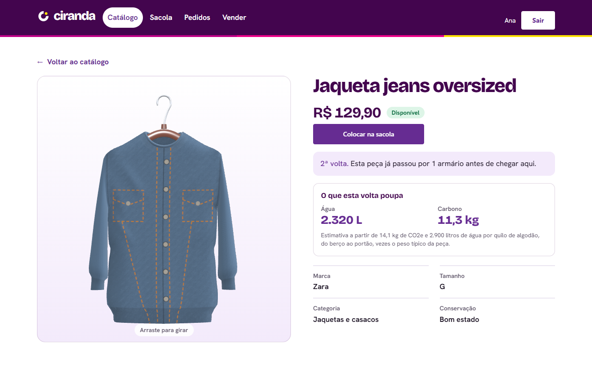
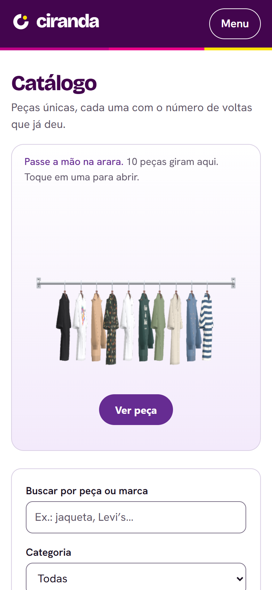
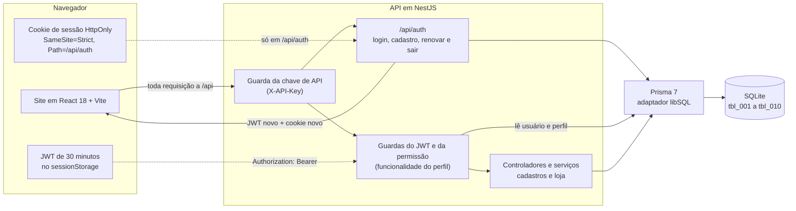
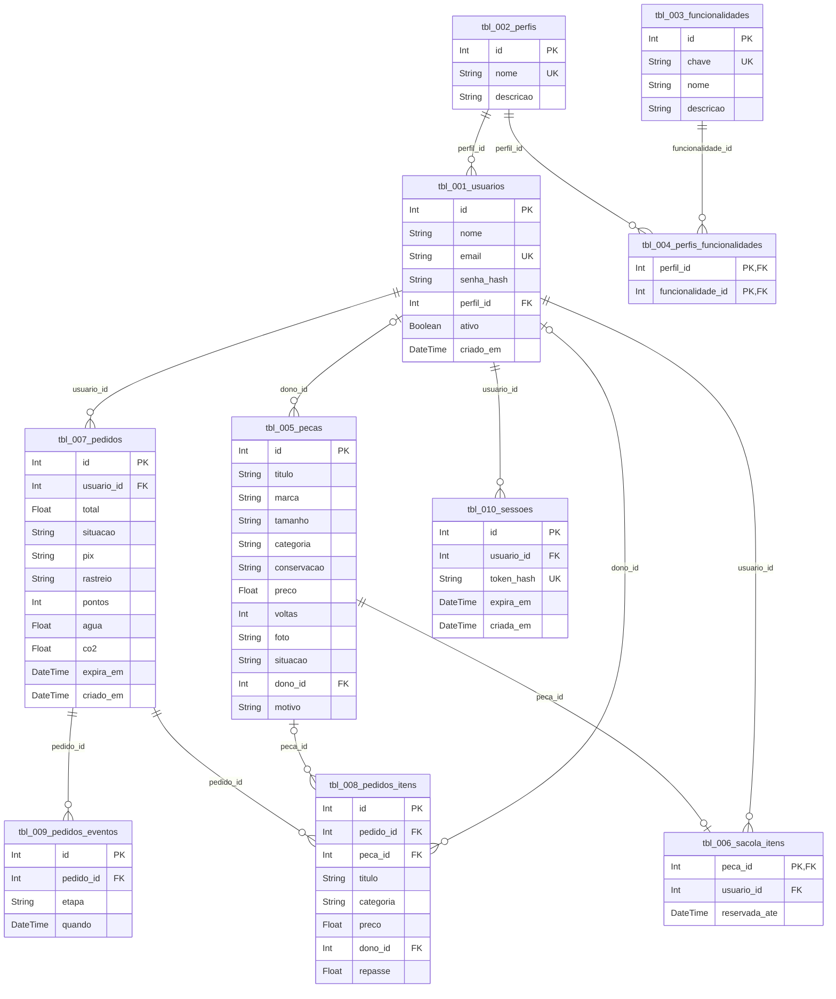

<p align="center">
  <picture>
    <source media="(max-width: 767px)" srcset="https://raw.githubusercontent.com/IsaacGomes260653/ceub_projeto_seminario_web_2026-1/main/.github/banner-mobile.svg">
    
  </picture>
</p>

<p align="center">
  <b>Ciranda é um brechó online: quem tem roupa parada deixa a peça em consignação, e quem procura reserva, paga com Pix simulado e acompanha o pedido.</b><br>
  Em volta dos três cadastros pedidos na disciplina (usuários, perfis e funcionalidades), com o acesso de cada tela e de cada rota definido pelo perfil.<br>
  <a href="https://ciranda-web.vercel.app"><b>Abrir o Ciranda</b></a> · contas de demonstração na própria tela de entrada, senha <code>ciranda123</code>
</p>

<p align="center">
  <a href="https://github.com/IsaacGomes260653/ceub_projeto_seminario_web_2026-1/actions/workflows/ci.yml"></a>
  <a href="https://github.com/IsaacGomes260653/ceub_projeto_seminario_web_2026-1/commits/main"></a>
  
</p>

<p align="center">
  <a href="#trabalho-em-grupo">Trabalho em grupo</a> ·
  <a href="#demonstração">Demonstração</a> ·
  <a href="#o-que-ele-faz">O que ele faz</a> ·
  <a href="#padrão-de-back-end-pedido-em-aula">Padrão de back-end</a> ·
  <a href="#stack">Stack</a> ·
  <a href="#como-rodar">Como rodar</a> ·
  <a href="#testes-e-qualidade">Testes</a> ·
  <a href="#estrutura-de-pastas">Estrutura</a> ·
  <a href="#english-summary">English</a>
</p>

## Trabalho em grupo

Projeto da disciplina de Desenvolvimento Web do CEUB, feito em grupo por:

- **Lucas Amaral Evangelista** · [@lucasamarale](https://github.com/lucasamarale)
- **Eduardo Clemente Cantuario** · [@Educlemente](https://github.com/Educlemente)
- **Bruno Rodrigues dos Santos** · [@Brunobrs86](https://github.com/Brunobrs86)
- **Isaac Gomes de Moraes** · [@IsaacGomes260653](https://github.com/IsaacGomes260653)

Repositório original: [lucasamarale/ceub_projeto_seminario_web_2026-1](https://github.com/lucasamarale/ceub_projeto_seminario_web_2026-1). Cópia publicada com a autorização do grupo, com o histórico de commits completo e a autoria original de cada um.

## Sumário

1. [Demonstração](#demonstração)
2. [O que ele faz](#o-que-ele-faz)
3. [Padrão de back-end pedido em aula](#padrão-de-back-end-pedido-em-aula)
4. [Stack](#stack)
5. [Arquitetura](#arquitetura)
6. [Modelo de dados](#modelo-de-dados)
7. [Rotas da API](#rotas-da-api)
8. [Como rodar](#como-rodar)
9. [Testes e qualidade](#testes-e-qualidade)
10. [Solução de problemas](#solução-de-problemas)
11. [Estrutura de pastas](#estrutura-de-pastas)
12. [English summary](#english-summary)

## Demonstração

<p align="center">
  
</p>

Gravado com o Playwright, com a API e o site rodando localmente a partir de um clone limpo e os dados de demonstração do próprio projeto. O site tem só o tema claro.

<p align="center">
  
</p>

<p align="center">
  
</p>

No celular, o menu vira um botão e a arara continua girando com o dedo:

<p align="center">
  
  
</p>

## O que ele faz

**Os três cadastros da disciplina, com acesso por perfil.** Cada usuário tem um perfil, e cada perfil tem um conjunto de funcionalidades. O menu só mostra o que o perfil permite, e a API confere a permissão de novo a cada requisição, lendo o usuário no banco: quem chamar a API direto, sem passar pela tela, também é barrado. Há ainda um quarto cadastro, de peças, que alimenta o catálogo.

| Conta de demonstração | Perfil | O que enxerga |
| --- | --- | --- |
| lucia@ciranda.app | Administradora | Tudo, incluindo Usuários, Perfis, Funcionalidades e Bastidores |
| beatriz@ciranda.app | Fornecedor | Catálogo, sacola, pedidos, vender em consignação e cadastro de peças |
| ana@ciranda.app | Cliente | Catálogo, sacola, pedidos e vender em consignação |

A senha das três é `ciranda123`, e os dados são fictícios.

**A loja em volta dos cadastros:**

- **Cadastro aberto.** Qualquer pessoa cria conta e entra sempre como Cliente: o perfil nunca vem do formulário.
- **Sacola com reserva.** Colocar na sacola reserva a peça por 30 minutos. Duas pessoas não reservam a mesma peça, e a reserva vencida volta sozinha ao catálogo.
- **Pix simulado.** Fechar a sacola gera um pedido com um código Pix de mentira e um prazo. Um botão faz o papel do banco e abre a tela de comprado, com confetes. Nenhum dinheiro circula.
- **Pedidos e rastreio.** Linha do tempo de Pago a Entregue, com histórico e código de rastreio simulado. Cada pessoa vê só os próprios pedidos; o pedido de outra pessoa responde 404.
- **Consignação.** A pessoa envia a peça, o brechó aprova ou recusa com motivo, e a venda gera um repasse de 60% para quem enviou.
- **Impacto e pontos.** Cada peça mostra a água e o carbono que aquela volta poupa, e cada compra paga soma pontos. Categoria sem fator confiável não mostra número.
- **Bastidores.** Vendido, a repassar, fila de consignação e os pedidos para mover de etapa.
- **Arara 3D.** No topo do catálogo, camisetas, camisas, moletons e jaquetas ficam penduradas numa arara que gira com o mouse ou o dedo, cada tecido com a sua trama. O pacote 3D só é baixado quando o catálogo abre, e em aparelho sem WebGL a arara some e a lista continua inteira.

As funcionalidades da loja (`sacola.usar`, `consignacao.publicar`, `consignacao.aprovar` e `bastidores.ver`) entram no mesmo cadastro de funcionalidades e podem ser dadas a qualquer perfil.

Para ver tudo em cinco minutos: entre como Ana, abra uma peça, coloque na sacola, feche o pedido e confirme o Pix simulado. Em Vender, envie uma peça. Depois entre como Lúcia e abra Bastidores para aprovar a peça e mover o pedido.

**Segurança:**

- **Chave de API:** toda rota de `/api` exige o cabeçalho `X-API-Key`, comparado em tempo constante (a exceção é `/api/saude`). Num site que roda no navegador, essa chave identifica o cliente, mas não é segredo; quem protege os dados é o token.
- **Tokens:** o login devolve um JWT assinado, válido por 30 minutos, e grava um cookie `HttpOnly` de sessão, de uso único, que renova o JWT. A senha fica guardada com bcrypt.
- **CSRF:** as rotas de dados não aceitam cookie. O cookie é `SameSite=Strict`, só vale em `/api/auth`, e requisição de origem fora da lista recebe 403.
- **CORS:** só as origens em `CORS_ORIGENS` são aceitas.
- **CSP:** a API responde com `default-src 'none'`, e o site restringe scripts, estilos, imagens e conexões à própria origem.
- **Camada 7:** limite de requisições por minuto (mais apertado no login), corpo limitado a 100 kB e um filtro que recusa padrões conhecidos de ataque na URL e no corpo. Na Vercel, o firewall da borda tem ainda uma regra que nega caminhos típicos de varredura (`/.env`, `/.git`, `/wp-admin`).
- **SQL:** todo acesso ao banco passa pelo Prisma, que parametriza as consultas.

## Padrão de back-end pedido em aula

O professor pediu que o back-end siga estes itens e que o projeto tenha uma skill com eles. A skill está em [`.claude/skills/padrao-backend/SKILL.md`](.claude/skills/padrao-backend/SKILL.md), e cada item está no código:

| Item | Como foi feito | Onde está |
| --- | --- | --- |
| **Framework: NestJS** | API em NestJS com TypeScript: módulo, controladores, serviços, guardas, interceptador e filtro de erros. | `backend/src/app.module.ts` |
| **HTTP: métodos** | GET lê, POST cria ou executa ação, PUT substitui, DELETE remove. | Controladores em `backend/src/*/` |
| **HTTP: status codes** | 200, 201, 204, 400, 401, 403, 404, 409, 413, 429 e 500, cada um com um sentido só. | `backend/src/comum/erros.ts` e `filtro-de-erros.ts` |
| **HTTP: headers** | `X-API-Key`, `Authorization: Bearer`, cabeçalhos de segurança do helmet e de limite de taxa. | `backend/src/comum/seguranca.ts` |
| **HTTP: cookies** | Cookie de sessão `HttpOnly`, `Secure`, `SameSite=Strict`, restrito a `/api/auth`. | `backend/src/auth/auth.controller.ts` |
| **HTTP: CORS** | Lista de origens permitidas. Origem fora da lista recebe 403. | `corsRestrito` em `backend/src/comum/seguranca.ts` |
| **APIs REST com Swagger** | Documentação gerada do código, com corpo, respostas e esquemas de segurança de cada rota. | <https://ciranda-web.vercel.app/api/docs> e `backend/src/app.ts` |
| **ORM e migrations: Prisma** | Todo acesso ao banco pelo cliente do Prisma. Mudança de banco só por migration. | `backend/prisma/schema.prisma` e `backend/prisma/migrations/` |
| **Padrão de tabelas** | `tbl` + número + nome: `tbl_001_usuarios` até `tbl_010_sessoes`. Um teste lê o banco e falha se alguma tabela fugir do padrão. | `backend/prisma/schema.prisma` e `backend/test/plataforma.test.js` |
| **OWASP: SQL injection** | Consultas parametrizadas pelo Prisma. Nenhum valor de requisição é colado em SQL. | `backend/src/banco/prisma.service.ts` |
| **OWASP: XSS** | API só devolve JSON com CSP `default-src 'none'`. O React escapa todo texto. Sessão longa em cookie `HttpOnly`. | `backend/src/comum/seguranca.ts` e `vercel.json` |
| **OWASP: CSRF** | Rotas de dados pedem JWT no cabeçalho, não cookie. Cookie `SameSite=Strict`, origem conferida e cabeçalho `X-API-Key` obrigatório. | Testes "CSRF" em `backend/test/plataforma.test.js` |
| **Hash de senhas** | bcrypt com custo 10. O hash nunca sai da API. | `backend/src/auth/auth.service.ts` e `backend/src/usuarios/usuarios.ts` |
| **Criptografia** | JWT assinado com HMAC SHA-256. Token de sessão aleatório de 32 bytes, guardado no banco só como SHA-256. | `backend/src/auth/auth.service.ts` |
| **HTTPS** | O site só responde por HTTPS, a API manda `Strict-Transport-Security` e o cookie sai com `Secure`. | `backend/src/comum/seguranca.ts` |
| **Validação de entrada** | Todo corpo e toda consulta passam por regras de tipo, tamanho e formato. Campo fora da regra é descartado. | `backend/src/comum/validar.ts` |
| **Gestão de segredos** | Segredos só em variável de ambiente. Em produção a API não sobe sem eles. | `backend/src/config.ts` e `backend/.env.example` |
| **JWT com o front** | JWT de 30 minutos no cabeçalho `Authorization`, renovado pelo cookie de sessão sem a pessoa perceber. | `backend/src/comum/guardas.ts` e `frontend/src/api.js` |

## Stack

| Parte | Tecnologias |
| --- | --- |
| Back-end (`backend/`) | Node 22.13 ou mais novo, NestJS 12 com TypeScript, Prisma 7 com SQLite, Swagger, JWT (`jsonwebtoken`), bcryptjs, Helmet, `express-rate-limit` |
| Front-end (`frontend/`) | React 18 com Vite 5, React Router 6, Tailwind CSS 3 e Materialize 2 |
| Testes | Vitest com Supertest (API), Vitest com Testing Library (site) e Cypress 16 (de ponta a ponta) |
| CI e publicação | GitHub Actions e Vercel, com o site e a API como dois serviços do mesmo projeto (`vercel.json`) |

O banco tem dez tabelas no padrão `tbl_NNN_nome`, de `tbl_001_usuarios` a `tbl_010_sessoes`, definidas em `backend/prisma/schema.prisma` e criadas por migration. Quando a API sobe, ela aplica as migrations e grava os dados de demonstração. A documentação da API, gerada pelo Swagger, fica em <https://ciranda-web.vercel.app/api/docs>.

As cores seguem a Central da Marca do CEUB; o logotipo da instituição não é usado. A arara e os modelos de camiseta, moletom e camisa vêm do componente Clothes Rack, de DiMaac UI. A página do componente não informa a licença, então o repositório traz só o pacote compilado (`frontend/public/arara3d/`), sem o código-fonte dele.

## Arquitetura



- **Front-end:** o site em React fala só com `/api`. Em desenvolvimento, o Vite repassa `/api` para a API em `localhost:3333`; na Vercel, o site e a API são dois serviços do mesmo projeto (`vercel.json`).
- **Chave de API:** uma guarda global confere o `X-API-Key` em toda rota, menos em `/api/saude`.
- **JWT:** o login devolve um JWT de 30 minutos, que o site guarda no `sessionStorage` e manda no cabeçalho `Authorization`. A cada requisição, a guarda lê no banco o usuário, o perfil e as funcionalidades.
- **Cookie de sessão:** o login também grava um cookie `HttpOnly` com um token de uso único, que o banco guarda só como hash SHA-256 (`tbl_010_sessoes`). Quando o JWT vence, o site chama `POST /api/auth/renovar`, recebe um JWT novo e um cookie novo e repete a chamada uma vez.
- **Banco:** todo acesso passa pelo Prisma. Sem `BANCO` no `.env`, a API usa um SQLite descartável, aplica as migrations e grava os dados de demonstração ao subir.

## Modelo de dados

Gerado a partir de [`backend/prisma/schema.prisma`](backend/prisma/schema.prisma), com os nomes físicos das tabelas e das colunas:



- **Acesso:** cada usuário tem um perfil, e a `tbl_004_perfis_funcionalidades` liga cada perfil às funcionalidades dele.
- **Peça na sacola:** a `peca_id` é a chave da `tbl_006_sacola_itens`, então uma peça cabe em uma sacola só por vez.
- **Peça de consignação:** a `dono_id` da peça fica vazia quando a peça é do acervo do brechó.
- **Item do pedido:** guarda uma cópia do título, da categoria e do preço, para o pedido não mudar se a peça for editada depois.
- **Exclusões, pelas regras das chaves estrangeiras:** apagar um usuário apaga a sacola, os pedidos e as sessões dele; nas peças e nos itens de pedido, a `dono_id` fica vazia. Um perfil com usuários não pode ser apagado, nem uma funcionalidade que algum perfil usa.

## Rotas da API

Resumo tirado dos controladores. A documentação completa, com o corpo e as respostas de cada rota, fica no Swagger: <https://ciranda-web.vercel.app/api/docs> (ou <http://localhost:3333/api/docs> com a API rodando localmente).

Toda rota pede o cabeçalho `X-API-Key`, menos `/api/saude`. Nas rotas marcadas com uma funcionalidade, a pessoa precisa estar logada (JWT no cabeçalho `Authorization`) e o perfil dela precisa ter essa funcionalidade; "logado" quer dizer qualquer perfil.

| Método | Rota | Quem pode acessar | Para que serve |
| --- | --- | --- | --- |
| GET | `/api/saude` | Qualquer um, sem a chave | Diz se a API está no ar |
| POST | `/api/auth/login` | Só a chave | Entra com e-mail e senha: devolve o JWT e grava o cookie de sessão |
| POST | `/api/auth/cadastro` | Só a chave | Cria uma conta, sempre com o perfil Cliente |
| POST | `/api/auth/renovar` | Só a chave, com o cookie de sessão | Troca o cookie de sessão por um JWT novo |
| POST | `/api/auth/sair` | Só a chave | Encerra a sessão: apaga a sessão no banco e o cookie |
| GET | `/api/auth/eu` | Logado | Diz quem está logado, com o perfil e as funcionalidades |
| GET, POST | `/api/usuarios` | `usuarios.gerenciar` | Lista e cria usuários |
| GET, PUT, DELETE | `/api/usuarios/:id` | `usuarios.gerenciar` | Busca, edita e remove um usuário |
| GET | `/api/perfis` | `perfis.gerenciar` ou `usuarios.gerenciar` | Lista os perfis |
| POST | `/api/perfis` | `perfis.gerenciar` | Cria um perfil com as funcionalidades dele |
| GET, PUT, DELETE | `/api/perfis/:id` | `perfis.gerenciar` | Busca, edita e remove um perfil (só remove perfil sem usuários) |
| GET | `/api/funcionalidades` | `funcionalidades.gerenciar` ou `perfis.gerenciar` | Lista as funcionalidades |
| POST | `/api/funcionalidades` | `funcionalidades.gerenciar` | Cria uma funcionalidade |
| GET, PUT, DELETE | `/api/funcionalidades/:id` | `funcionalidades.gerenciar` | Busca, edita e remove uma funcionalidade (só remove a que nenhum perfil usa) |
| GET | `/api/pecas`, `/api/pecas/:id` | `catalogo.ver` | Lista o catálogo e busca uma peça. Quem não gerencia o acervo não vê peça em análise nem recusada |
| POST | `/api/pecas` | `pecas.gerenciar` | Cadastra uma peça no acervo |
| PUT, DELETE | `/api/pecas/:id` | `pecas.gerenciar` | Edita e remove uma peça |
| GET, POST | `/api/sacola` | `sacola.usar` | Mostra a própria sacola e coloca uma peça nela, reservada por 30 minutos |
| DELETE | `/api/sacola/:pecaId` | `sacola.usar` | Tira a peça da sacola, e ela volta ao catálogo |
| GET | `/api/pedidos` | `sacola.usar`; com `?todos=1`, `bastidores.ver` | Lista os próprios pedidos ou, com `todos=1`, os de todo mundo |
| GET | `/api/pedidos/:id` | Logado | Busca um pedido. O de outra pessoa responde 404, a não ser para quem tem `bastidores.ver` |
| POST | `/api/pedidos` | `sacola.usar` | Fecha a sacola num pedido, com o código Pix simulado e 30 minutos para pagar |
| POST | `/api/pedidos/:id/pagar` | `sacola.usar` | Confirma o Pix simulado: vende as peças, gera o rastreio e soma os pontos |
| POST | `/api/pedidos/:id/cancelar` | `sacola.usar` | Cancela um pedido ainda não pago |
| POST | `/api/pedidos/:id/avancar` | `bastidores.ver` | Move o pedido para a etapa seguinte: Pago, Em separação, Enviado, Entregue |
| GET | `/api/consignacoes` | `consignacao.publicar`; com `?fila=1`, `consignacao.aprovar` | Lista as próprias peças em consignação ou, com `fila=1`, as que esperam análise |
| POST | `/api/consignacoes` | `consignacao.publicar` | Envia uma peça para análise |
| POST | `/api/consignacoes/:id/aprovar` | `consignacao.aprovar` | Aprova a peça, que entra no catálogo |
| POST | `/api/consignacoes/:id/recusar` | `consignacao.aprovar` | Recusa a peça, com motivo |
| DELETE | `/api/consignacoes/:id` | `consignacao.publicar` | Retira uma peça que ainda não entrou no catálogo |
| GET | `/api/impacto` | `sacola.usar` | Mostra o que as compras da pessoa já pouparam |
| GET | `/api/bastidores` | `bastidores.ver` | Painel do brechó: vendido, a repassar, peças e pedidos por situação |

Nos dados de demonstração, a Administradora tem todas as funcionalidades; o Fornecedor tem `catalogo.ver`, `pecas.gerenciar`, `sacola.usar` e `consignacao.publicar`; e o Cliente tem `catalogo.ver`, `sacola.usar` e `consignacao.publicar`.

## Como rodar

Precisa do Git e do Node 22.13 ou mais novo.

```bash
git clone https://github.com/IsaacGomes260653/ceub_projeto_seminario_web_2026-1.git
cd ceub_projeto_seminario_web_2026-1

# terminal 1: API em http://localhost:3333, documentação em http://localhost:3333/api/docs
cd backend
npm install        # também gera o cliente do Prisma
npm run build
npm start

# terminal 2: site em http://localhost:5173
cd frontend
npm install
npm run dev
```

Abra <http://localhost:5173> e toque numa das contas de demonstração. Num clone limpo, a instalação das duas pastas levou cerca de 20 segundos (Windows 11 e Node 26).

- Não precisa de `.env`: sem ele, a API usa a chave e o segredo de desenvolvimento, e o Vite manda o `/api` para a API local. Os modelos estão em `backend/.env.example` e `frontend/.env.example`.
- Sem `.env`, a API sobe com um banco SQLite descartável, aplica as migrations e volta aos dados de demonstração toda vez que reinicia. Para guardar os dados em arquivo e usar os comandos do Prisma:

  ```bash
  cd backend
  cp .env.example .env                     # ajuste BANCO=dados/ciranda.db
  npm run migrar:producao                  # prisma migrate deploy: cria as tabelas
  npm run migrar -- --name minha_mudanca   # prisma migrate dev: cria uma migration nova
  npm run migracoes:empacotar              # atualiza o SQL que a API aplica no banco descartável
  ```
- O `npm install` do front-end baixa o Cypress, que é grande. Para só rodar o site, dá para pular esse download com `CYPRESS_INSTALL_BINARY=0 npm install`.

## Testes e qualidade

```bash
cd backend && npm test                         # 97 testes, com relatório de cobertura
cd frontend && npm test                        # 105 testes, com relatório de cobertura
cd frontend && npm run build && npm run e2e    # sobe API e site e roda o Cypress
```

Na última execução do grupo, os 97 e os 105 testes passaram, com 100% das linhas cobertas no back-end e no front-end. O limite de 80% está nos dois `vitest.config`, e a CI falha abaixo disso. O Cypress tem 30 testes em `frontend/cypress/e2e/`.

Os testes usam quatro tipos de dublê:

- **Mock:** `vi.fn()` no lugar do `fetch`, para conferir cabeçalhos e chamadas (`frontend/src/api.test.js`).
- **Fake:** uma API inteira em memória, com regras parecidas com as da real (`frontend/src/teste/apiFalsa.js`).
- **Fixture:** respostas prontas em JSON que o Cypress entrega no lugar do servidor (`frontend/cypress/fixtures/`).
- **Stub:** a arara 3D trocada por um dublê no Cypress (`frontend/cypress/e2e/03-simulado.cy.js`).

A cada push ou pull request, o GitHub Actions (`.github/workflows/ci.yml`) confere o esquema do Prisma, roda os testes e o build do back-end, os testes e o build do front-end e, depois, o Cypress com a API e o site no ar.

## Solução de problemas

A CI roda em Linux (`ubuntu-latest`). Os problemas abaixo aparecem só no Windows e foram reproduzidos no Windows 11 com o Node 26, a partir deste repositório.

**`EPERM, Permission denied` nos testes do back-end.** Quase todos os testes do `npm test` aparecem como falhos, com o erro apontando para `test/preparo.js` e para um arquivo `ciranda-….db` na pasta temporária.

- **Causa:** depois de cada teste, o `preparo.js` apaga o banco SQLite temporário daquele teste. No Windows, o arquivo ainda está aberto nesse momento, e o Windows não deixa apagar arquivo aberto; o Linux deixa. O erro está na limpeza, não nas verificações: com a limpeza ignorando o `EPERM`, 95 dos 97 testes passaram (os outros dois estão no próximo item).
- **O que fazer:** use o resultado da CI como referência, ou rode os testes do back-end num Linux, como o WSL. Os bancos que não foram apagados ficam na pasta temporária; para limpar, no PowerShell: `Remove-Item "$env:TEMP\ciranda-*.db*"`.

**Dois testes de `test/plataforma.test.js` falham no Windows.**

- *"o SQL que a API aplica ao subir é o mesmo da pasta prisma/migrations"*, com a mensagem `rode npm run migracoes:empacotar`: o Git do Windows vem com `core.autocrlf=true` e troca o fim de linha dos arquivos para CRLF no clone, e o teste compara o texto exato dos arquivos. Não rode o `migracoes:empacotar` por causa disso, porque ele gravaria os CRLF no arquivo empacotado. Clone sem a conversão: `git clone -c core.autocrlf=false https://github.com/IsaacGomes260653/ceub_projeto_seminario_web_2026-1.git`.
- *"resolve o endereço do banco"*: o teste espera um caminho no formato do Linux (`file:/…/dados/x.db`), e no Windows o caminho começa com a letra do disco (`file:C:\…`).

**`npm run e2e` não roda no Windows.** O script `start:e2e` do back-end define variáveis no formato `NOME=valor comando`, que o `cmd.exe` usado pelo npm no Windows não entende (`'LIMITE_LOGIN_POR_MINUTO' não é reconhecido como um comando interno`). Além disso, o `start-server-and-test` tenta encerrar os servidores com o `wmic.exe`, que as versões recentes do Windows 11 não trazem mais: ele cai com `spawn wmic.exe ENOENT` e deixa os servidores rodando. Para rodar o Cypress, use três terminais do PowerShell:

```powershell
# terminal 1: API com os limites do teste e banco descartável
cd backend
npm run build
$env:LIMITE_LOGIN_POR_MINUTO="1000"; $env:LIMITE_POR_MINUTO="5000"; $env:BANCO=":memory:"; node dist/main.js

# terminal 2: site já compilado, em http://localhost:4173
cd frontend
npm run build
npm run preview

# terminal 3: Cypress
cd frontend
npm run cy:run
```

**O teste dos confetes falha no Cypress.** Se os *Efeitos de animação* do Windows estiverem desligados (Configurações → Acessibilidade → Efeitos visuais), o navegador informa `prefers-reduced-motion: reduce`, e a tela de comprado não solta confetes de propósito (`frontend/src/componentes/Festa.jsx`). O teste *"reserva uma peça, fecha o pedido e paga com Pix simulado"* espera os confetes e falha. Para esse teste passar, os efeitos de animação precisam estar ligados.

**`npm run dev` do back-end não sobe a API no Windows.** O script junta dois comandos com `&`, que no `cmd.exe` roda um depois do outro, e o primeiro (`tsc --watch`) não termina nunca. Use `npm run build` e `npm start`, como em [Como rodar](#como-rodar), ou rode cada comando num terminal: `npx tsc -p tsconfig.build.json --watch` e `node --watch dist/main.js`.

## Estrutura de pastas

```
.
├── .claude/
│   └── skills/padrao-backend/  # skill com o padrão de back-end pedido em aula
├── backend/
│   ├── prisma/             # esquema do banco (tabelas tbl_NNN_nome) e migrations
│   ├── src/
│   │   ├── app.module.ts   # módulo do NestJS com controladores e serviços
│   │   ├── app.ts          # monta a API: segurança, chave de API e Swagger
│   │   ├── auth/           # login, JWT e cookie de sessão
│   │   ├── banco/          # serviço do Prisma, migrations e dados de demonstração
│   │   ├── comum/          # CORS, CSP, limite de taxa, guardas, validação e erros
│   │   └── usuarios/ ...   # usuários, perfis, funcionalidades, peças e a loja
│   └── test/               # Vitest com Supertest
├── frontend/
│   ├── src/
│   │   ├── paginas/        # Catálogo, Peça, Sacola e Pedidos, Vender, Bastidores, cadastros
│   │   ├── componentes/    # layout, arara 3D, formulários e a tela de comprado
│   │   └── teste/          # API falsa e apoio dos testes
│   ├── cypress/            # testes de ponta a ponta e fixtures
│   └── public/             # fotos das peças e o pacote da arara 3D
├── .github/                # CI, banner e capturas deste README
└── vercel.json             # o site e a API como dois serviços do mesmo projeto
```

---

## English summary

**Ciranda** is an online thrift store built as a group project for the Web Development course at CEUB (Brasília): people leave clothes on consignment, others reserve, pay with a simulated Pix and track the order. **[Open Ciranda](https://ciranda-web.vercel.app)** (Portuguese interface; demo accounts on the sign-in page, password `ciranda123`).

- **Team:** Lucas Amaral Evangelista ([@lucasamarale](https://github.com/lucasamarale)), Eduardo Clemente Cantuario ([@Educlemente](https://github.com/Educlemente)), Bruno Rodrigues dos Santos ([@Brunobrs86](https://github.com/Brunobrs86)) and Isaac Gomes de Moraes ([@IsaacGomes260653](https://github.com/IsaacGomes260653)). Original repository: [lucasamarale/ceub_projeto_seminario_web_2026-1](https://github.com/lucasamarale/ceub_projeto_seminario_web_2026-1); this copy is published with the group's permission, with the full commit history and original authorship.
- **What it does:** CRUD for users, profiles and features, where each profile's features decide what the menu shows and what the API allows; plus a cart that holds items for 30 minutes, simulated Pix payment, order tracking, consignment with a 60% payout, a back-office panel and a 3D clothes rack.
- **Stack:** NestJS 12 with TypeScript, Prisma 7 with SQLite and migrations, Swagger, JWT with a refresh cookie and an API key on the back end; React 18, Vite, Tailwind CSS and Materialize on the front end; Vitest, Supertest, Testing Library and Cypress; GitHub Actions and Vercel.
- **Tests:** 97 back-end and 105 front-end tests (100% line coverage on both, 80% enforced in CI) and 30 Cypress end-to-end tests.
- **Back-end standard asked in class:** HTTP methods, status codes, headers, cookies and CORS, Swagger docs (<https://ciranda-web.vercel.app/api/docs>), Prisma migrations, `tbl_NNN_name` tables, OWASP (SQL injection, XSS, CSRF), password hashing, HTTPS, input validation and secrets in environment variables. The project skill is in `.claude/skills/padrao-backend/SKILL.md`.

**Run it:** Node 22.13 or newer. Run `npm install`, `npm run build` and `npm start` in `backend/` (API on port 3333, docs at `/api/docs`), then `npm install` and `npm run dev` in `frontend/` (site on <http://localhost:5173>). No `.env` is needed for local development.
