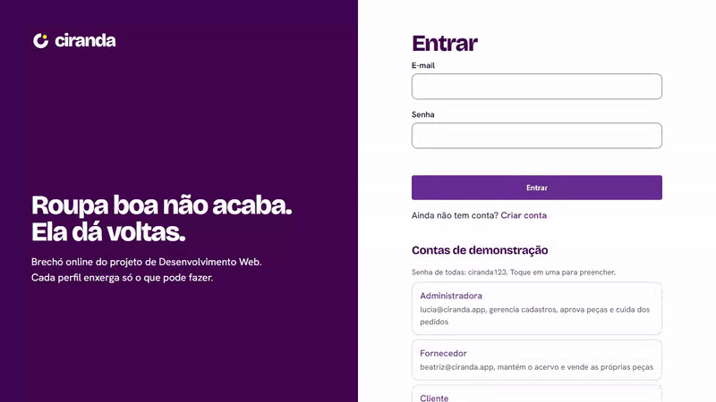
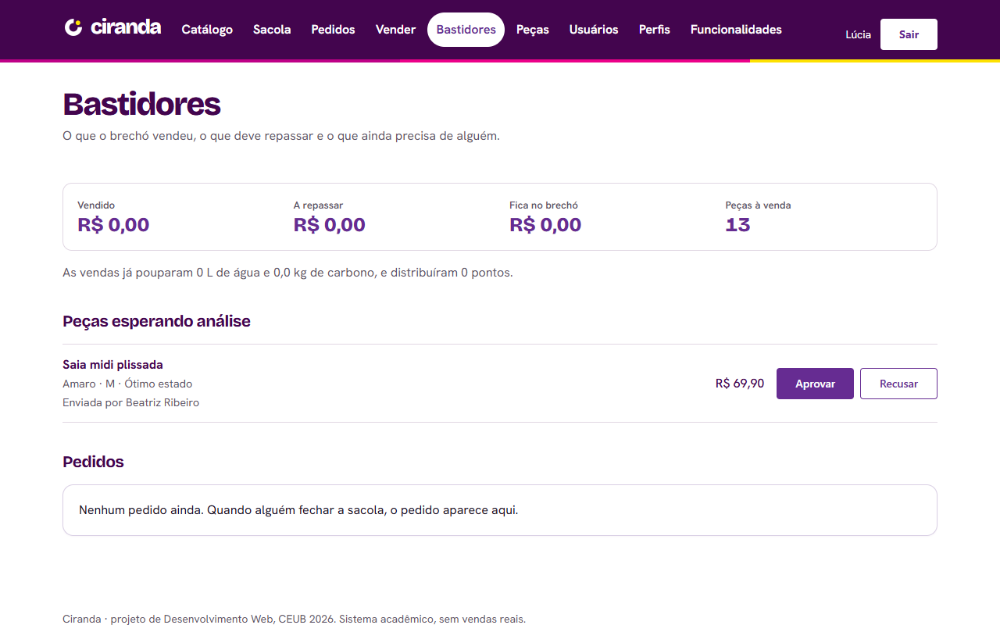
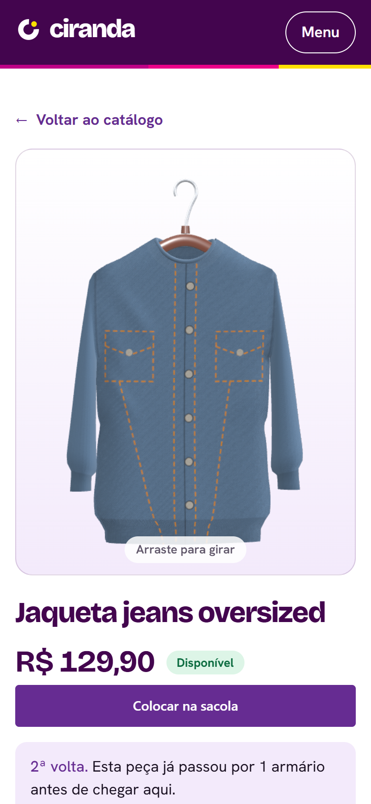

<p align="center">
  <picture>
    <source media="(max-width: 767px)" srcset="https://raw.githubusercontent.com/IsaacGomes260653/ceub_projeto_seminario_web_2026-1/main/.github/banner-mobile.svg">
    
  </picture>
</p>

<p align="center">
  <b>Ciranda é um brechó online: quem tem roupa parada deixa a peça em consignação, e quem procura reserva, paga com Pix simulado e acompanha o pedido.</b><br>
  Em volta dos três cadastros pedidos na disciplina (usuários, perfis e funcionalidades), com o acesso de cada tela e de cada rota definido pelo perfil.<br>
  <a href="https://ciranda-web.vercel.app"><b>Abrir o Ciranda</b></a> · contas de demonstração na própria tela de entrada, senha <code>ciranda123</code>
</p>

<p align="center">
  <a href="https://github.com/IsaacGomes260653/ceub_projeto_seminario_web_2026-1/actions/workflows/ci.yml"></a>
  <a href="https://github.com/IsaacGomes260653/ceub_projeto_seminario_web_2026-1/commits/main"></a>
  
</p>

<p align="center">
  <a href="#trabalho-em-grupo">Trabalho em grupo</a> ·
  <a href="#demonstração">Demonstração</a> ·
  <a href="#o-que-ele-faz">O que ele faz</a> ·
  <a href="#stack">Stack</a> ·
  <a href="#como-rodar">Como rodar</a> ·
  <a href="#testes-e-qualidade">Testes</a> ·
  <a href="#estrutura-de-pastas">Estrutura</a> ·
  <a href="#english-summary">English</a>
</p>

## Trabalho em grupo

Projeto da disciplina de Desenvolvimento Web do CEUB, feito em grupo por:

- **Lucas Amaral Evangelista** · [@lucasamarale](https://github.com/lucasamarale)
- **Eduardo Clemente Cantuario** · [@Educlemente](https://github.com/Educlemente)
- **Bruno Rodrigues dos Santos** · [@Brunobrs86](https://github.com/Brunobrs86)
- **Isaac Gomes de Moraes** · [@IsaacGomes260653](https://github.com/IsaacGomes260653)

Repositório original: [lucasamarale/ceub_projeto_seminario_web_2026-1](https://github.com/lucasamarale/ceub_projeto_seminario_web_2026-1). Cópia publicada com a autorização do grupo, com o histórico de commits completo e a autoria original de cada um.

## Demonstração

<p align="center">
  
</p>

Gravado com o Playwright, com a API e o site rodando localmente a partir de um clone limpo e os dados de demonstração do próprio projeto. O site tem só o tema claro.

<p align="center">
  
</p>

<p align="center">
  
</p>

No celular, o menu vira um botão e a arara continua girando com o dedo:

<p align="center">
  
  
</p>

## O que ele faz

**Os três cadastros da disciplina, com acesso por perfil.** Cada usuário tem um perfil, e cada perfil tem um conjunto de funcionalidades. O menu só mostra o que o perfil permite, e a API confere a permissão de novo a cada requisição, lendo o usuário no banco: quem chamar a API direto, sem passar pela tela, também é barrado. Há ainda um quarto cadastro, de peças, que alimenta o catálogo.

| Conta de demonstração | Perfil | O que enxerga |
| --- | --- | --- |
| lucia@ciranda.app | Administradora | Tudo, incluindo Usuários, Perfis, Funcionalidades e Bastidores |
| beatriz@ciranda.app | Fornecedor | Catálogo, sacola, pedidos, vender em consignação e cadastro de peças |
| ana@ciranda.app | Cliente | Catálogo, sacola, pedidos e vender em consignação |

A senha das três é `ciranda123`, e os dados são fictícios.

**A loja em volta dos cadastros:**

- **Cadastro aberto.** Qualquer pessoa cria conta e entra sempre como Cliente: o perfil nunca vem do formulário.
- **Sacola com reserva.** Colocar na sacola reserva a peça por 30 minutos. Duas pessoas não reservam a mesma peça, e a reserva vencida volta sozinha ao catálogo.
- **Pix simulado.** Fechar a sacola gera um pedido com um código Pix de mentira e um prazo. Um botão faz o papel do banco e abre a tela de comprado, com confetes. Nenhum dinheiro circula.
- **Pedidos e rastreio.** Linha do tempo de Pago a Entregue, com histórico e código de rastreio simulado. Cada pessoa vê só os próprios pedidos; o pedido de outra pessoa responde 404.
- **Consignação.** A pessoa envia a peça, o brechó aprova ou recusa com motivo, e a venda gera um repasse de 60% para quem enviou.
- **Impacto e pontos.** Cada peça mostra a água e o carbono que aquela volta poupa, e cada compra paga soma pontos. Categoria sem fator confiável não mostra número.
- **Bastidores.** Vendido, a repassar, fila de consignação e os pedidos para mover de etapa.
- **Arara 3D.** No topo do catálogo, camisetas, camisas, moletons e jaquetas ficam penduradas numa arara que gira com o mouse ou o dedo, cada tecido com a sua trama. O pacote 3D só é baixado quando o catálogo abre, e em aparelho sem WebGL a arara some e a lista continua inteira.

As funcionalidades da loja (`sacola.usar`, `consignacao.publicar`, `consignacao.aprovar` e `bastidores.ver`) entram no mesmo cadastro de funcionalidades e podem ser dadas a qualquer perfil.

Para ver tudo em cinco minutos: entre como Ana, abra uma peça, coloque na sacola, feche o pedido e confirme o Pix simulado. Em Vender, envie uma peça. Depois entre como Lúcia e abra Bastidores para aprovar a peça e mover o pedido.

**Segurança:**

- **Chave de API:** toda rota de `/api` exige o cabeçalho `X-API-Key`, comparado em tempo constante. Num site que roda no navegador, essa chave identifica o cliente, mas não é segredo; quem protege os dados é o token.
- **Tokens:** o login devolve um JWT assinado, válido por 30 minutos. A senha fica guardada com bcrypt.
- **CORS:** só as origens em `CORS_ORIGENS` são aceitas.
- **CSP:** a API responde com `default-src 'none'`, e o site restringe scripts, estilos, imagens e conexões à própria origem.
- **Camada 7:** limite de requisições por minuto (mais apertado no login), corpo limitado a 100 kB e um filtro que recusa padrões conhecidos de ataque na URL e no corpo. Na Vercel, o firewall da borda tem ainda uma regra que nega caminhos típicos de varredura (`/.env`, `/.git`, `/wp-admin`).
- **SQL:** todas as consultas usam parâmetros.

## Stack

| Parte | Tecnologias |
| --- | --- |
| Back-end (`backend/`) | Node 22.13 ou mais novo, Express 4, SQLite embutido do Node (`node:sqlite`), JWT (`jsonwebtoken`), bcryptjs, Helmet, `express-rate-limit` |
| Front-end (`frontend/`) | React 18 com Vite 5, React Router 6, Tailwind CSS 3 e Materialize 2 |
| Testes | Vitest com Supertest (API), Vitest com Testing Library (site) e Cypress 16 (de ponta a ponta) |
| CI e publicação | GitHub Actions e Vercel, com o site e a API como dois serviços do mesmo projeto (`vercel.json`) |

O banco tem nove tabelas: `usuarios`, `perfis`, `funcionalidades`, `perfil_funcionalidades`, `pecas`, `sacola_itens`, `pedidos`, `pedido_itens` e `pedido_eventos`. Ele é criado e preenchido com os dados de demonstração quando a API sobe.

As cores seguem a Central da Marca do CEUB; o logotipo da instituição não é usado. A arara e os modelos de camiseta, moletom e camisa vêm do componente Clothes Rack, de DiMaac UI. A página do componente não informa a licença, então o repositório traz só o pacote compilado (`frontend/public/arara3d/`), sem o código-fonte dele.

## Como rodar

Precisa do Git e do Node 22.13 ou mais novo, porque a API usa o SQLite que já vem no Node.

```bash
git clone https://github.com/IsaacGomes260653/ceub_projeto_seminario_web_2026-1.git
cd ceub_projeto_seminario_web_2026-1

# terminal 1: API em http://localhost:3333
cd backend
npm install
npm run dev

# terminal 2: site em http://localhost:5173
cd frontend
npm install
npm run dev
```

Abra <http://localhost:5173> e toque numa das contas de demonstração. Num clone limpo, a instalação das duas pastas levou cerca de 20 segundos (Windows 11 e Node 26).

- Não precisa de `.env`: sem ele, a API usa a chave e o segredo de desenvolvimento, e o Vite manda o `/api` para a API local. Os modelos estão em `backend/.env.example` e `frontend/.env.example`.
- Sem `.env`, o banco fica em memória e volta aos dados de demonstração toda vez que a API reinicia. Para gravar em disco, copie o `backend/.env.example` para `backend/.env`: ele aponta o banco para `./dados/ciranda.sqlite`.
- O `npm install` do front-end baixa o Cypress, que é grande. Para só rodar o site, dá para pular esse download com `CYPRESS_INSTALL_BINARY=0 npm install`.

## Testes e qualidade

```bash
cd backend && npm test                         # 73 testes, com relatório de cobertura
cd frontend && npm test                        # 100 testes, com relatório de cobertura
cd frontend && npm run build && npm run e2e    # sobe API e site e roda o Cypress
```

Rodei os dois primeiros e o build num clone limpo: 73 e 100 testes passando, com 99,8% das linhas cobertas no back-end e 100% no front-end. O limite de 80% está nos dois `vitest.config`, e a CI falha abaixo disso. O Cypress tem 29 testes em `frontend/cypress/e2e/`.

Os testes usam quatro tipos de dublê:

- **Mock:** `vi.fn()` no lugar do `fetch`, para conferir cabeçalhos e chamadas (`frontend/src/api.test.js`).
- **Fake:** uma API inteira em memória, com regras parecidas com as da real (`frontend/src/teste/apiFalsa.js`).
- **Fixture:** respostas prontas em JSON que o Cypress entrega no lugar do servidor (`frontend/cypress/fixtures/`).
- **Stub:** a arara 3D trocada por um dublê no Cypress (`frontend/cypress/e2e/03-simulado.cy.js`).

A cada push ou pull request, o GitHub Actions (`.github/workflows/ci.yml`) roda os testes do back-end, os testes e o build do front-end e, depois, o Cypress com a API e o site no ar.

## Estrutura de pastas

```
.
├── backend/
│   ├── src/
│   │   ├── app.js          # monta o Express: segurança, chave de API e rotas
│   │   ├── db.js           # esquema do SQLite e dados de demonstração
│   │   ├── auth.js         # JWT e checagem de funcionalidade por rota
│   │   ├── seguranca.js    # CORS, CSP, limite de taxa e filtro de requisições
│   │   └── rotas/          # usuários, perfis, funcionalidades, peças, sacola, pedidos...
│   └── test/               # Vitest com Supertest
├── frontend/
│   ├── src/
│   │   ├── paginas/        # Catálogo, Peça, Sacola e Pedidos, Vender, Bastidores, cadastros
│   │   ├── componentes/    # layout, arara 3D, formulários e a tela de comprado
│   │   └── teste/          # API falsa e apoio dos testes
│   ├── cypress/            # testes de ponta a ponta e fixtures
│   └── public/             # fotos das peças e o pacote da arara 3D
├── .github/                # CI, banner e capturas deste README
└── vercel.json             # o site e a API como dois serviços do mesmo projeto
```

---

## English summary

**Ciranda** is an online thrift store built as a group project for the Web Development course at CEUB (Brasília): people leave clothes on consignment, others reserve, pay with a simulated Pix and track the order. **[Open Ciranda](https://ciranda-web.vercel.app)** (Portuguese interface; demo accounts on the sign-in page, password `ciranda123`).

- **Team:** Lucas Amaral Evangelista ([@lucasamarale](https://github.com/lucasamarale)), Eduardo Clemente Cantuario ([@Educlemente](https://github.com/Educlemente)), Bruno Rodrigues dos Santos ([@Brunobrs86](https://github.com/Brunobrs86)) and Isaac Gomes de Moraes ([@IsaacGomes260653](https://github.com/IsaacGomes260653)). Original repository: [lucasamarale/ceub_projeto_seminario_web_2026-1](https://github.com/lucasamarale/ceub_projeto_seminario_web_2026-1); this copy is published with the group's permission, with the full commit history and original authorship.
- **What it does:** CRUD for users, profiles and features, where each profile's features decide what the menu shows and what the API allows; plus a cart that holds items for 30 minutes, simulated Pix payment, order tracking, consignment with a 60% payout, a back-office panel and a 3D clothes rack.
- **Stack:** Express 4 with Node's built-in SQLite, JWT and an API key on the back end; React 18, Vite, Tailwind CSS and Materialize on the front end; Vitest, Supertest, Testing Library and Cypress; GitHub Actions and Vercel.
- **Tests:** 73 back-end and 100 front-end tests (99.8% and 100% line coverage, 80% enforced in CI) and 29 Cypress end-to-end tests.

**Run it:** Node 22.13 or newer. Run `npm install` and `npm run dev` in `backend/` (API on port 3333) and again in `frontend/` (site on <http://localhost:5173>). No `.env` is needed for local development.
